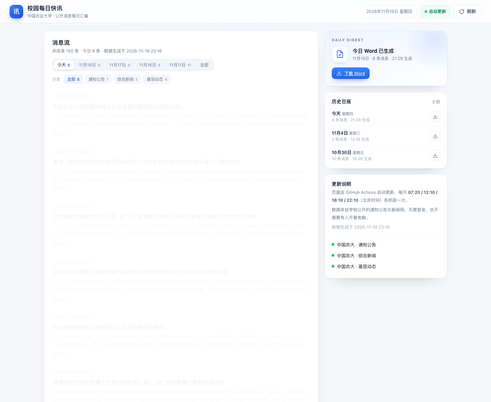

# 校园每日快讯

校园官网消息聚合工具：每天抓取学校公开的通知公告和新闻，自动汇编成当天的一份 **Word 日报**，在网页上查看、下载。

- **在线版（推荐）**：部署到 GitHub Pages，得到一个公开网址，别人打开就能看，每天自动更新，不需要开电脑。
- **本地版**：在本机运行网页应用，可以手动抓取、改设置。



## 在线版：GitHub Pages

一次部署后你会得到一个自己的网址：

- 任何人打开都能看当天的消息、下载当天 Word
- GitHub Actions 每天 4 次自动抓取（北京时间 07:20 / 12:10 / 18:10 / 22:10）
- 不需要服务器、不需要开电脑，公开仓库免费

部署步骤见 [DEPLOY.md](DEPLOY.md)。

## 已实现的功能

- **可配置的数据源**：支持多个来源（通知公告、新闻动态……），每个来源可单独设置网址和 CSS 选择器
- **自动识别列表**：不填选择器时，会尝试从页面中自动找出新闻列表
- **自动去重**：按原文链接去重，重复抓取不会产生重复消息
- **按天归档**：每条消息记录发布日期，界面按「今天 / 昨天 / 更早」浏览
- **分类筛选**：按通知公告 / 综合新闻 / 基层动态过滤，可和日期筛选叠加
- **一键生成 Word**：标题、来源、发布时间、摘要、原文链接、页码，A4 排版
- **自动生成日报**：本地版每天 08:00；在线版每天 4 次，自动抓取并生成当天 Word
- **两种形态**：同一个配置，既能本机运行，也能发布成公开静态网站
- **已接入中国农大公开信息源**：通知公告、综合新闻、基层动态三个列表页，无需登录
- **示例数据源**：内置但默认关闭，接入其他站点前可用来演示完整流程
- **数据留在自己手里**：本地版存 SQLite，在线版存 `state/news.json`，不经过第三方服务

## 本地版（Flask）

macOS / Linux：

```bash
cd campus-daily-news
./run.sh
```

首次运行会自动创建 `.venv` 并安装依赖，随后打开 <http://127.0.0.1:7878>。

Windows（PowerShell）：

```powershell
cd campus-daily-news
python -m venv .venv
.\.venv\Scripts\pip install -r requirements.txt
.\.venv\Scripts\python app.py
```

也可以手动启动：

```bash
python3 -m venv .venv
.venv/bin/pip install -r requirements.txt
.venv/bin/python app.py
```

端口可用环境变量修改：`PORT=8000 ./run.sh`。

## 使用流程

1. 打开页面，点 **立即抓取**，会从中国农大公开的通知公告 / 新闻网拉取最新消息
2. 点 **生成今日 Word**，右侧「今日 Word」卡片出现下载按钮
3. 点右上角齿轮进入设置，可以增删数据源、调整抓取范围
4. 之后每天到点会自动抓取并生成文档

## 接入真实校园官网

在「设置 → 数据源」里填写（也直接改 `config.json`，保存后重启）：

| 字段 | 说明 | 示例 |
| --- | --- | --- |
| 名称 | 界面上显示的数据源名 | 通知公告 |
| 类型 | `网页` 抓取真实页面；`示例` 生成演示数据 | 网页 |
| 列表页网址 | 新闻/通知列表页地址 | `https://www.xxx.edu.cn/tzgg.htm` |
| 列表项选择器 | 每一条消息的外层容器 | `ul.news-list li` |
| 标题选择器 | 列表项中的标题元素 | `a` |
| 链接选择器 | 列表项中的链接元素 | `a` |
| 日期选择器 | 列表项中的日期元素（可选） | `span.date` |
| 摘要选择器 | 列表项中的摘要（可选） | `p.desc` |
| 正文选择器 | 详情页正文容器（可选，用于自动提取摘要） | `.article-content` |

**怎么找选择器**：浏览器打开列表页 → 右键某条新闻 → 检查 → 找到包住这条新闻的 `<li>`，看它的 class；「标题 / 链接」通常都是 `a`。

**先试自动识别**：列表项留空时程序会自己找列表，大多数学校官网能直接用；识别不准再补选择器。

日期支持 `2026-10-30`、`2026年10月30日`、`2026/10/30`、`10-30`、`30 2026.10`（日 + 年.月）等写法，带时间也可以。

## 中国农业大学（当前配置）

`one.cau.edu.cn` 办事大厅是统一身份认证入口，未登录会 302 跳到 `onecas.cau.edu.cn`，页面内容还是前端渲染的，**不适合直接抓**。本软件抓的是学校公开的信息页，同样每天更新、无需登录：

| 数据源 | 列表页 | 选择器（列表项 / 标题 / 链接 / 日期） |
| --- | --- | --- |
| 通知公告 | `https://www.cau.edu.cn/tzgg/index.htm` | `li .item` / `a.title` / `a.title` / `.time_box` |
| 综合新闻 | `https://news.cau.edu.cn/zhxwnew/index.htm` | `ul.ttgzList li` / `.title` / `a` / `.date` |
| 基层动态 | `https://news.cau.edu.cn/jcdt/index.htm` | `ul.ttgzList li` / `.title` / `a` / `.date` |

三个站的详情页正文都在 `.article` 里，程序会自动截取开头一段作为摘要。

**关于登录**：门户里的内容（办事大厅、校内通知）需要统一认证，软件不保存账号密码，也抓不了登录后的页面；如果以后确实需要，得单独做 Cookie 或接口方案。

## 定时与自动更新

- **在线版**：GitHub Actions 每天 07:20 / 12:10 / 18:10 / 22:10（北京时间）自动抓取并更新；GitHub 的定时任务可能延迟几分钟
- **本地版**：默认每天 08:00 抓取 + 生成，需要软件保持运行；到点时如果没开，启动后会自动补跑一次（每天最多一次）

## 目录结构

```
campus-daily-news/
├── app.py                # 本地版入口（Flask）
├── config.json           # 数据源配置（两种形态共用）
├── core/                 # 抓取、存储、Word 生成、定时
├── web/                  # 本地版前端
├── docs/                 # 在线版静态站（GitHub Pages）
│   ├── index.html
│   ├── app.js
│   ├── data.js           # 构建时生成
│   ├── files/            # 每日 Word
│   └── preview.png
├── state/news.json       # 在线版历史数据（提交到仓库）
├── scripts/build_site.py # 在线版构建：抓取 + 生成页面数据
├── .github/workflows/daily.yml
├── DEPLOY.md             # 在线版部署步骤
├── data/                 # 本地版运行数据
├── tests/                # 核心逻辑测试
├── run.sh                # 一键启动本地版
└── start.command         # macOS 双击启动
```

## 接口

| 方法 | 路径 | 说明 |
| --- | --- | --- |
| GET | `/api/state` | 日期列表、文档列表、配置、运行状态 |
| GET | `/api/news?day=today\|all\|YYYY-MM-DD` | 某天 / 全部消息 |
| POST | `/api/crawl` | 抓取；`{"dry_run": true}` 只预览不保存 |
| POST | `/api/digest` | 生成某天 Word，默认今天 |
| GET | `/api/download/<文件名>` | 下载 Word |
| POST | `/api/config` | 保存数据源与定时设置 |

## 测试

```bash
.venv/bin/python -m unittest discover -s tests -v
```

## 已知限制 / 下一步

- 抓的是公开页面；`one.cau.edu.cn` 这类要登录的门户暂不支持（后续可加 Cookie 配置，但门户是前端渲染，还需要找数据接口）
- 在线版是**定时抓取**，不是打开页面时实时抓：GitHub Pages 是静态托管，浏览器直接抓学校站点会被跨域拦截
- 在线版的抓取跑在 GitHub 的海外服务器上；如果学校站点限制海外访问，可能抓不到新数据（页面仍会显示已有内容）
- 每个数据源只抓列表第一页（约 10~20 条）；消息更新很快的站点可以再扩展翻页
- 纯 JS 渲染的站点抓不到内容，需要换成 Playwright 等方案
- `github.io` 在国内可能慢或打不开；可以绑定自定义域名，或改用国内云服务器部署 Flask 版
- 可以继续加：邮件/企业微信推送、PDF 导出、关键词过滤、多校区、附件下载

---

界面截图中的消息为学校公开信息，仅用于演示；在线版改 `config.json`，本地版在页面设置里改，两边是同一份数据源配置。
